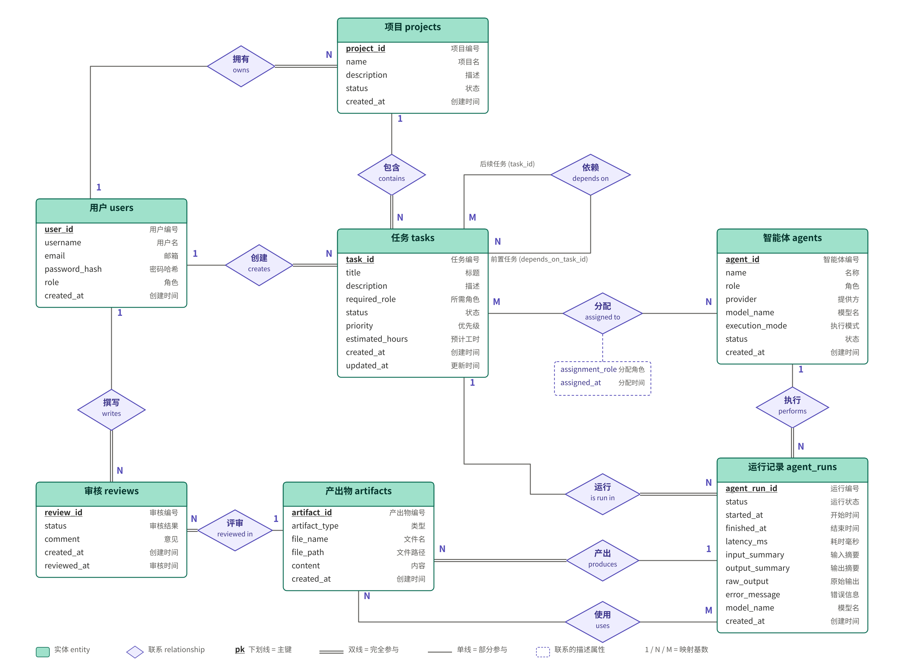
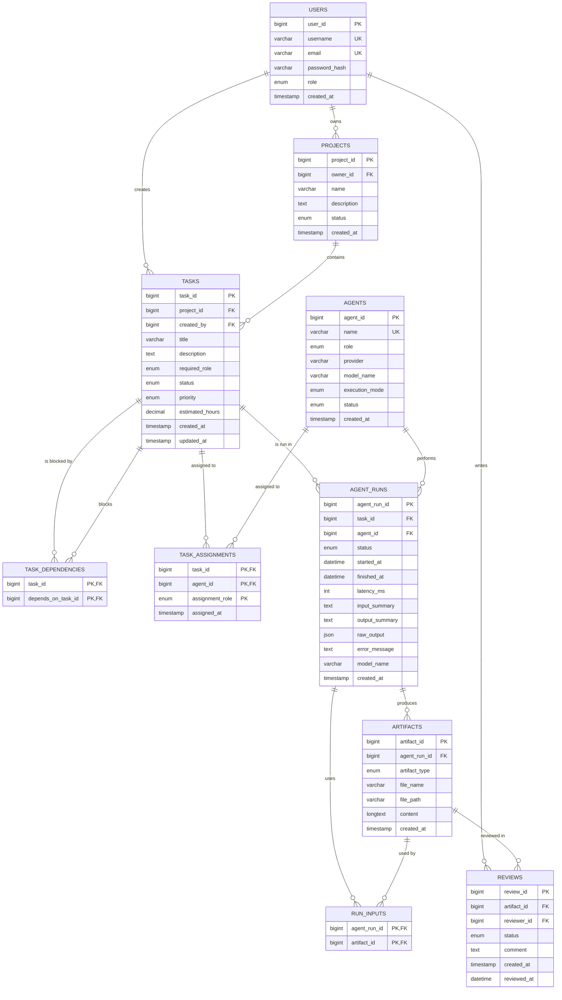

# AgentOps ER Diagram

## 1. Conceptual ER diagram (Chen notation)

Source: [`er_diagram_chen.svg`](er_diagram_chen.svg) (vector) · [`er_diagram_chen.png`](er_diagram_chen.png) (for slides).

Notation:

- Rectangle = entity set; the underlined attribute is the primary key.
- Diamond = relationship set; a dashed box attached to a diamond holds the relationship's descriptive attributes.
- `1` / `N` / `M` = mapping cardinality.
- Double line = total participation (every entity must take part); single line = partial participation.

Foreign keys are **not** listed inside the entities: in the conceptual model a link between entities is expressed by a relationship. Foreign keys only appear when the model is mapped to tables (section 2).

### Entity sets

| Entity | Primary key |
|---|---|
| 用户 `users` | `user_id` |
| 项目 `projects` | `project_id` |
| 任务 `tasks` | `task_id` |
| 智能体 `agents` | `agent_id` |
| 运行记录 `agent_runs` | `agent_run_id` |
| 产出物 `artifacts` | `artifact_id` |
| 审核 `reviews` | `review_id` |

### Relationship sets

| Relationship | Between | Cardinality | Participation |
|---|---|---|---|
| 拥有 owns | users — projects | 1 : N | every project has an owner (total) |
| 创建 creates | users — tasks | 1 : N | every task has a creator (total) |
| 包含 contains | projects — tasks | 1 : N | every task belongs to a project (total) |
| 依赖 depends on | tasks — tasks (recursive) | M : N | partial on both sides |
| 分配 assigned to | tasks — agents | M : N, attributes `assignment_role`, `assigned_at` | partial on both sides; a task has at most one `PRIMARY` agent |
| 运行 is run in | tasks — agent_runs | 1 : N | every run belongs to a task (total) |
| 执行 performs | agents — agent_runs | 1 : N | every run is performed by an agent (total) |
| 产出 produces | agent_runs — artifacts | 1 : N | every artifact comes from a run (total) |
| 使用 uses | agent_runs — artifacts | M : N | partial on both sides; a run uses the approved artifacts of its prerequisite tasks |
| 评审 reviewed in | artifacts — reviews | 1 : N | every review is about an artifact (total) |
| 撰写 writes | users — reviews | 1 : N | every review has a reviewer (total) |

## 2. Mapping to the relational schema

- Each entity set becomes a table whose primary key is `<entity>_id`.
- Each **1 : N** relationship becomes a foreign key on the N side, named after the key it references where possible (`tasks.project_id → projects.project_id`, `agent_runs.task_id → tasks.task_id`). Role names are used where the same entity appears with a specific role: `projects.owner_id`, `tasks.created_by` and `reviews.reviewer_id` all reference `users.user_id`.
- Each **M : N** relationship becomes its own table whose primary key is the combination of the participating keys:
  - 依赖 → `task_dependencies(task_id, depends_on_task_id)`, both referencing `tasks.task_id`; a `CHECK` forbids a task depending on itself.
  - 分配 → `task_assignments(task_id, agent_id, assignment_role, assigned_at)`, primary key `(task_id, agent_id, assignment_role)`; the descriptive attributes of the relationship become ordinary columns. A functional unique index `uk_one_primary_per_task` on `CASE WHEN assignment_role = 'PRIMARY' THEN task_id END` allows at most one `PRIMARY` agent per task (other roles produce `NULL`, which a unique index ignores).
  - 使用 → `run_inputs(agent_run_id, artifact_id)`, primary key `(agent_run_id, artifact_id)`.
- An artifact's task is not stored on `artifacts`; it is derived through its run (`artifacts.agent_run_id → agent_runs.task_id`). Storing it again would be redundant and could disagree with the run.

## 3. Notes

- `agent_runs` is an entity rather than a relationship between tasks and agents: the same task and agent can be paired in many runs, each run has its own lifecycle (`QUEUED → RUNNING → SUCCESS/FAILED`), and artifacts reference a specific run.
- When a task runs, the latest artifact of each prerequisite task that has an `ACCEPTED` review is passed to the agent as input, and each one is recorded in `run_inputs`. This is what links the agents into a chain: a tester sees the coder's approved code, a reviewer sees the tester's approved report.
- Task status only moves through the workflow: a run sets `IN_PROGRESS`, then `REVIEW` (or `DONE` for reviewer agents); a human approval of an unreviewed artifact sets `DONE`. Users may only switch between `TODO`, `BLOCKED` and `CANCELLED` directly.
- `tasks.status` is the current state of a task; `agent_runs` is its execution history.
- `artifacts.content` stores the generated Markdown/code text so the UI can display it without an external file service.
- Agent recommendations, risk scores and duplicate-task warnings are computed on demand from the data above and returned to the UI; they are not stored.
